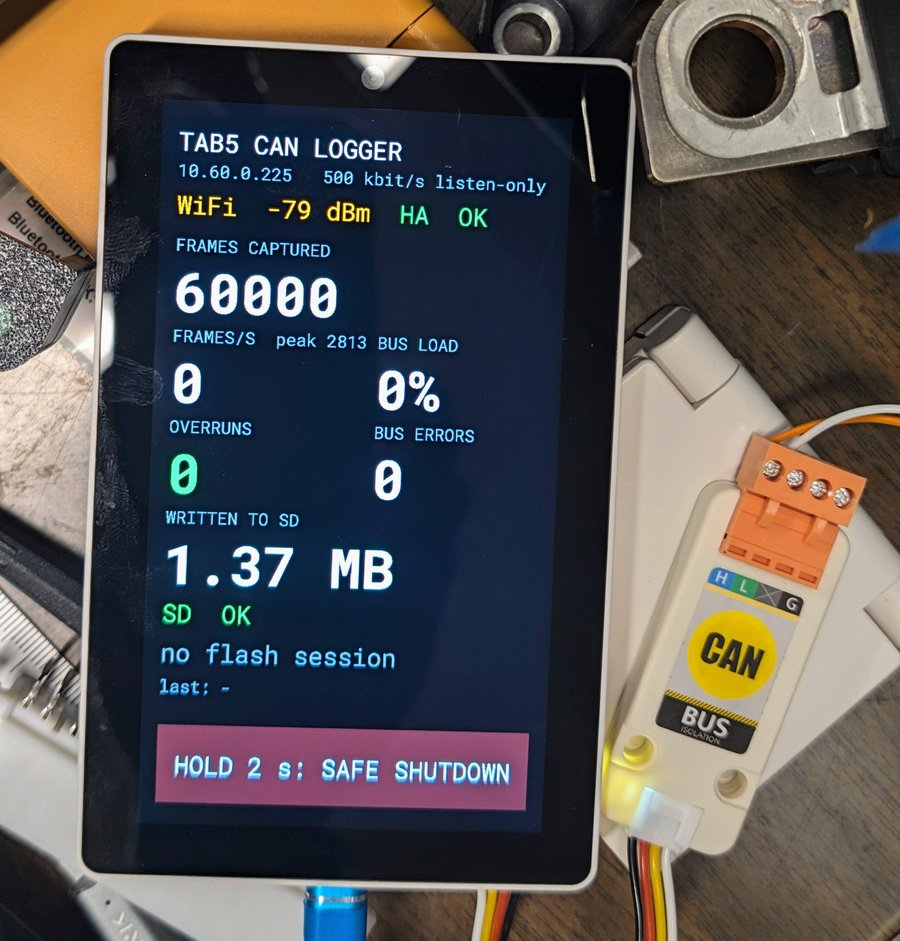
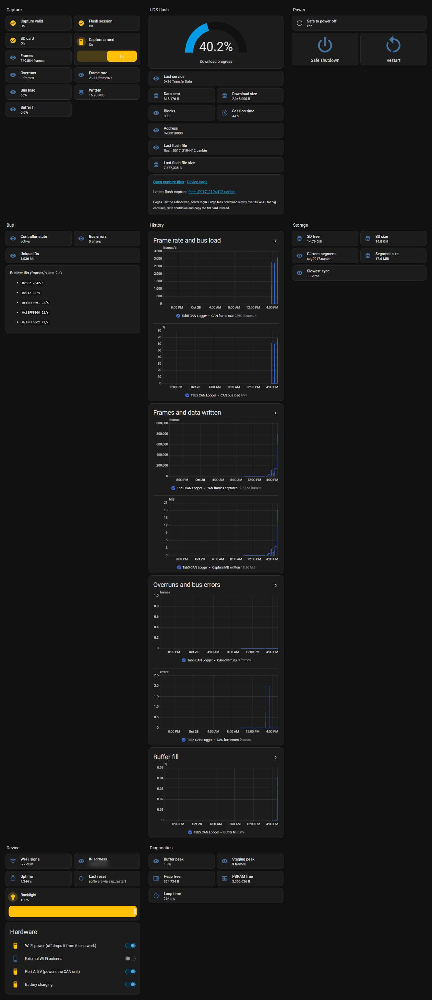
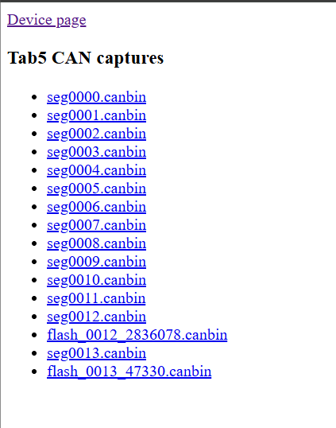

# canlogger-m5tab5

Lossless CAN logger on an **M5Stack Tab5 (ESP32-P4)** with an **M5 Unit CAN
(CA-IS3050G)**: it records every frame on the bus to the SD card, continuously,
for as long as it runs. It runs as an ESPHome external component, so the same
device streams status to Home Assistant, serves its capture files over HTTP and
shows live stats on the Tab5 screen.

A **CANable 2.0** next to it is the independent reference logger, and doubles as
a test-traffic generator on the desk. See [docs/TESTING.md](docs/TESTING.md).



*The status screen after a 60,000-frame desk test: peak 2,813 frames/s, 0
overruns, 0 bus errors. The M5 Unit CAN (CA-IS3050G) is on Port A.*

What it does:

- Logs **every frame** to the SD card, listen-only (no TX pin: it can't ACK or
  disturb the bus), with µs timestamps, in rotating `segNNNN.canbin` files.
- Counts any lost frame (`CAN overruns`) and clears **Capture valid** if one is
  lost, so a capture is only trusted when the count is 0.
- Screen and HA sensors: frames captured, frames/s (and peak), bus load %,
  overruns, bus errors, MB written, current segment, SD state and free space,
  Wi-Fi, HA link.
  Tap the screen's header for a details page: controller state, unique IDs and
  the 5 busiest IDs, buffer fill and high-water marks, SD space, current
  segment, slowest sync and uptime.
- Health sensors in HA: buffer fill/peak, staging peak, SD free/size, slowest
  sync, heap/PSRAM free, main-loop time, uptime and last reset reason.
- Device page with login (ESPHome `web_server`), capture list at `/files`,
  downloads at `/dl?f=<name>`. HA's device card links to it ("Visit").
- Safe shutdown (HA button, or hold the bar on screen for 2 s) closes the SD
  files before power-off; RESTART on screen resumes logging.

## Home Assistant

The device joins HA through the ESPHome integration. The example dashboard in
[homeassistant/dashboard.yaml](homeassistant/dashboard.yaml) has capture,
files, power, bus and diagnostics sections. The screenshot is from an earlier
version, which also tracked UDS flash sessions (that section has since been
replaced by a Files section):



## Repository

```
components/can_logger/     ESPHome external component (the capture engine)
esphome/                   device config, secrets.yaml.example, device-page link script
scripts/                   capture tools: convert, rebuild a UDS flash, CANable logger and test senders
tools/                     test helpers: Tab5 API, file download, log comparison
homeassistant/             example HA dashboard
canable-fw/                CANable 2.0 firmware notes and the board patch for Elmue's Candlelight
docs/TESTING.md            desk test procedure and results
```

## Hardware

| Part | Notes |
|---|---|
| M5Stack Tab5, **ST7123** display revision | Written for this revision (M5 sells three). If the screen stays black with no error, try display model `M5STACK-TAB5-ST7121`. |
| M5 Unit CAN (CA-IS3050G) on **Port A** | Yellow G53, white G54. `rx_pin: GPIO54`; if frames stay at 0 on a live bus, use `GPIO53`. No `tx_pin` is configured, so wiring it the other way round can't drive the bus. |
| microSD card | FAT32. The component mounts it and never formats it. |
| Separate 5 V supply | A PC USB port wasn't enough: Wi-Fi failed once the SD card was mounted. |
| CANable 2.0 (optional) | Reference logger and desk test sender. Needs gs_usb firmware for listen-only; see [canable-fw](canable-fw/README.md). |

## Build and flash

```bash
cp esphome/secrets.yaml.example esphome/secrets.yaml   # then fill it in
esphome run esphome/tab5-canlog.yaml                     # USB the first time
esphome run esphome/tab5-canlog.yaml --device <tab5-ip>  # OTA afterwards
```

Built and tested with **ESPHome 2026.7.2** (ESP-IDF 5.5.5). Building in Linux or
WSL is much faster than native Windows (90 s against 12 min for a clean build
here).

## Capturing

1. Power the Tab5, check the screen: SD OK, overruns 0.
2. Optional: start the reference logger on a PC with the CANable on the same bus:
   ```bash
   python scripts/canable_log.py -o canable.log
   ```
3. Leave it running. Every frame goes to `segNNNN.canbin`; a new segment starts
   every 64 MB (about 20 minutes at 2,300 frames/s).
4. Before pulling power: **Safe shutdown**, wait for SAFE TO POWER OFF.
5. Get the files from the device page, `python tools/tab5_fetch.py <tab5-ip> seg`
   (the newest segment), or the SD card (much faster than Wi-Fi for big files).
   The device page links to the capture list at `/files`; each name downloads
   the file:

   
6. Convert and cross-check:
   ```bash
   python scripts/canbin2candump.py seg0012.canbin -o tab5.log -i can0
   python tools/compare_logs.py subset tab5.log canable.log
   ```
   `subset` checks that every frame the CANable logged is in the Tab5 capture in
   the same order, and lists frames only the Tab5 has (timestamps differ; frames
   must not).
7. To rebuild a UDS-over-CAN firmware download from a capture, point
   `reassemble_uds.py` at the segment holding it, with the tester's request id:
   ```bash
   python scripts/reassemble_uds.py seg0012.canbin --tx-id 0x602 -o image.bin
   ```
   It prints each block and checks the total against the size announced in
   `0x34` (MATCH/MISMATCH).

## How the capture stays lossless

```
on_rx_done (IRAM, cache-safe ISR)        runs even while the flash cache is off (OTA, NVS writes)
  → twai_node_receive_from_isr()
  → internal-RAM staging ring            an IRAM ISR can't touch PSRAM
capture_task (core 1, priority 20)
  → 24-byte record → PSRAM ring (16 MB)
writer_task (core 0, priority 5)
  → SD segment file, fsync every second
ESPHome loop (priority 1)
  → HA entities, web server, screen, rate/bus-load maths
```

- Built on the ESP-IDF **`esp_twai` node API** with the ISR in IRAM
  (`CONFIG_TWAI_ISR_IN_IRAM`, `CONFIG_TWAI_ISR_CACHE_SAFE`), following
  jonny5532's native TWAI driver in his Battery-Emulator fork. ESPHome's own
  `canbus` component isn't used: it's serviced from the main loop and drops
  frames on a busy bus.
- Loss is caught where it can happen: staging-ring overflow (ISR outran the task)
  and PSRAM-ring overflow (SD stalled). Either adds to `CAN overruns` and sets the
  `GAP` flag on the next record that gets through.
- The screen and HA can't hold up capture: the capture task always preempts
  ESPHome's loop (whose longest pass, mostly redrawing the screen, is ~200-260
  ms). Its per-frame extra work for the statistics is a few counter increments
  (rate, bus bits, per-ID count) and a high-water compare. ID ranking and rates
  are worked out in ESPHome's loop, and the SD's free space is read once at mount
  (FatFS's free-space scan can be slow), then estimated from what's been written.
- The bus state comes from the driver's `on_state_change` callback, not
  `twai_node_get_info()`: with a listen-only node and no TX queue, the latter's
  status path asserts on a null queue.
- Measured: up to ~2,700 frames/s on the desk (8-byte frames, ~60 % bus load)
  and ~2,300 frames/s on a live vehicle bus, with 0 overruns (see
  docs/TESTING.md). The buffers (2,048 frames in internal RAM, 16 MB in PSRAM,
  about 100 KB/s to SD at full load) leave room for more; not yet tested above
  ~2,800 frames/s.

## Capture files (`.canbin`, little-endian)

32-byte `FileHeader` (`CANBIN01`, version, record size, bitrate, epoch), then
fixed **24-byte records**: µs timestamp, id (bit 31 extended, bit 30 RTR,
bit 29 meta), dlc, flags (bit 0 `GAP`: frames were lost before this one), 8 data
bytes. The layout is defined in `can_logger.h` and mirrored by the scripts.

Files are `segNNNN.canbin`: everything, rotating at 64 MB (`seg_bytes`).
Numbering continues from the highest file on the card, so a reboot never
overwrites a capture. Older firmware also carved UDS flash sessions into
`flash_<boot>_<ms>.canbin`, framed by `FLASH_START`/`FLASH_END` meta records
(event codes 2 and 3); the scripts still read those. Event codes 1, 4 and 5 are
reserved.

Timestamps are µs since boot (no wall clock yet).

## Notes and limits

- **Powering off:** files are synced every second, but FAT has no journal; a
  power cut during a directory or FAT-table write can still corrupt a file. Use
  Safe shutdown. The card stays mounted on purpose: unmounting would deinit the
  SDMMC host the C6 Wi-Fi shares.
- **Classic CAN only:** the P4's TWAI controllers don't do CAN FD.
- **SD space:** a busy bus fills a card fast (~190 MB/hour at 2,300 frames/s).
  Nothing is deleted automatically, and once the card is full, writes fail
  without counting as overruns: keep an eye on **SD free**.
- **Wi-Fi downloads are slow** on a weak signal (seconds to minutes per MB). For
  big captures, copy the SD card.
- `reassemble_uds.py` handles normal-addressing ISO-TP with one tester id. Check
  the rebuilt size (MATCH) and the image's own header/CRC.
- The Tab5 never transmits, so a desk test needs a sender that doesn't need an
  ACK: the CANable in external loopback (see docs/TESTING.md).
- ESPHome strips IDF components it thinks are unused; the component re-includes
  `esp_driver_twai`, `fatfs` and `wear_levelling` and turns on long file names.
- Tab5 hardware details (pins from M5's docs and BSP): SD on SDMMC slot 0 (CLK 43,
  CMD 44, D0–D3 39–42, IO powered by on-chip LDO 4), C6 Wi-Fi on SDIO slot 1, Wi-Fi
  power `pi4ioe2` P0, Port A 5 V `pi4ioe1` P2 (both forced on), DSI PHY on LDO 3 at
  2.5 V, backlight G22, touch ST7123 at I2C 0x55 (interrupt G23). LCD_RST
  (`pi4ioe1` P4) is pulled low then released as an input with pull-up, never
  driven high (as M5's BSP does).

## License

GNU General Public License v3.0, see [LICENSE](LICENSE). The patch in
`canable-fw/` applies to Elmue's CANable 2.5 firmware, which has its own terms.
